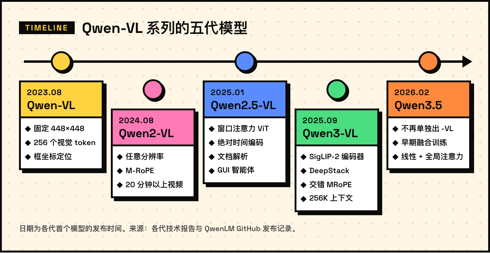
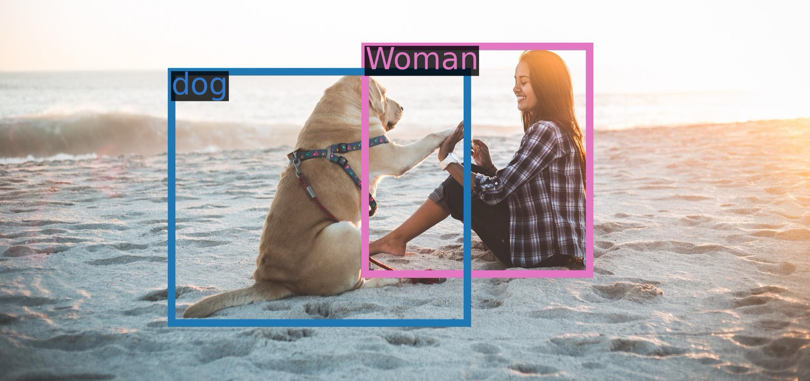
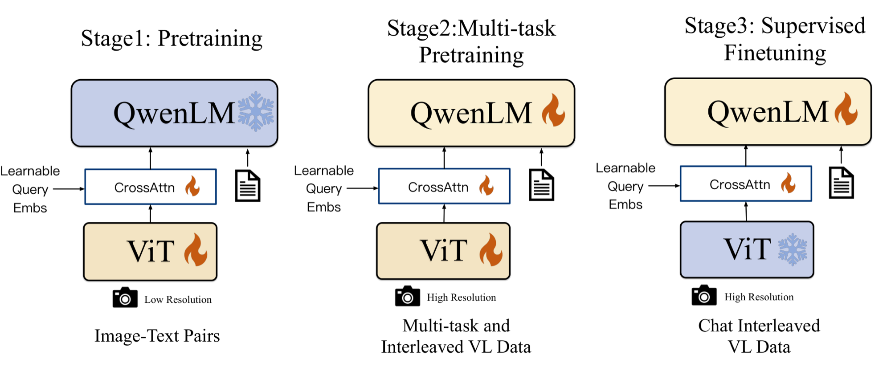
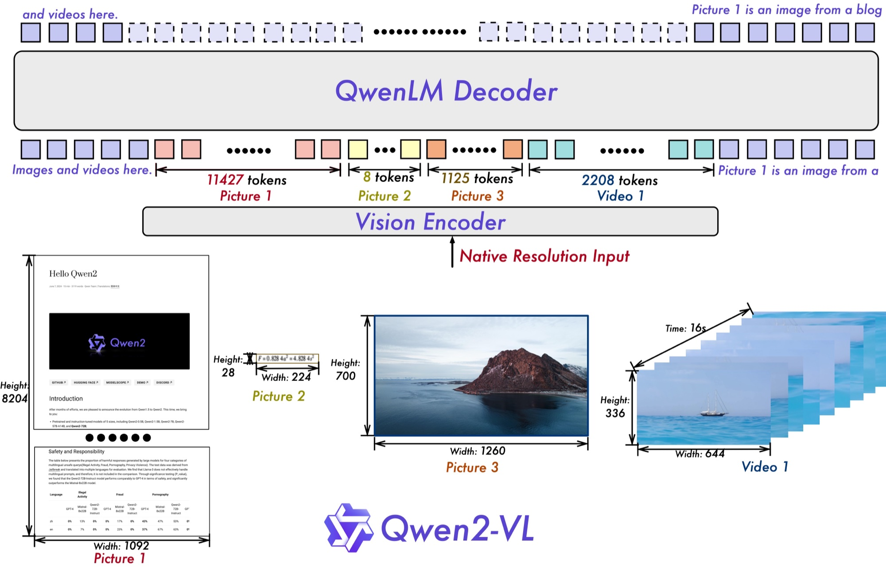
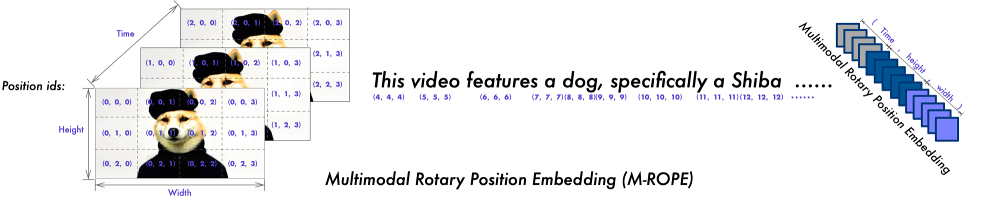
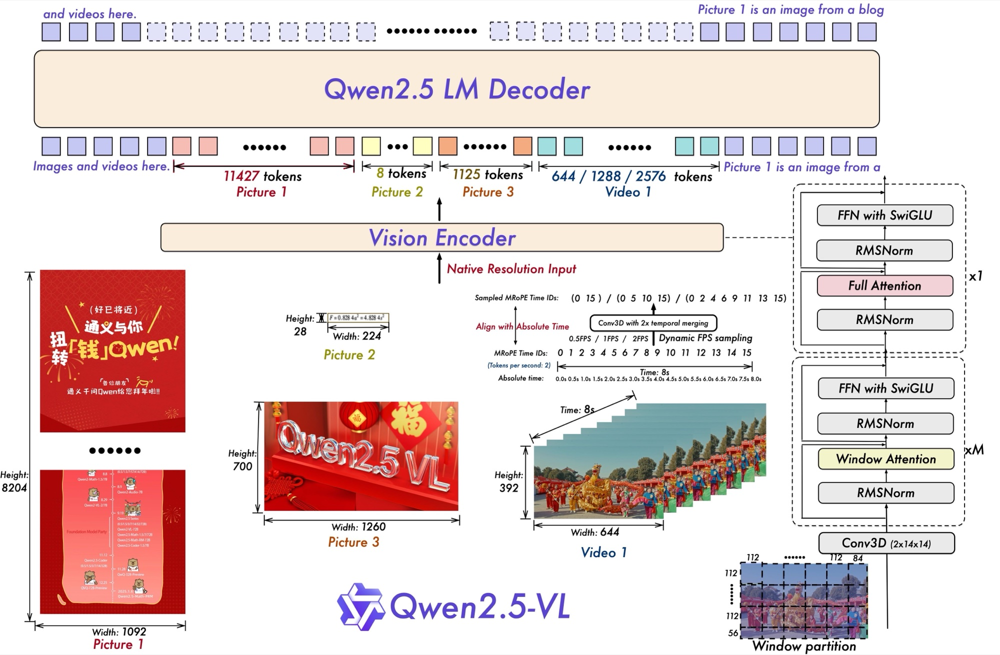
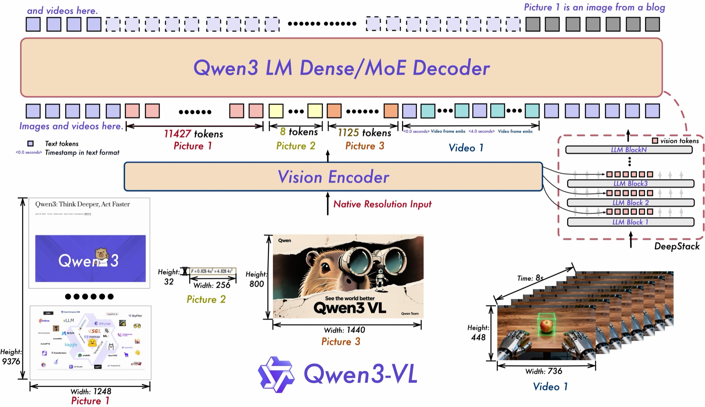
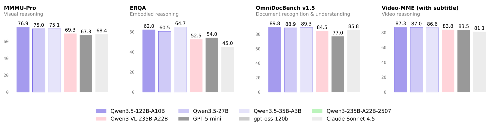

从 2023 年 8 月的 Qwen-VL 到 2026 年 2 月的 Qwen3.5，通义千问的视觉语言模型走过了五代。前四代都以「-VL」单独命名，到了 Qwen3.5，视觉能力直接做进了主线模型。这篇文章按时间顺序梳理每一代改了什么、为什么这样改，主要看四个问题：图片怎样变成 token，位置和时间怎样编码，视觉和语言怎样融合，模型最后能做什么。



## 五代模型一览

| 代际 | 主要尺寸 | 视觉编码器 | 视觉 token | 位置编码 |
| --- | --- | --- | --- | --- |
| Qwen-VL | 9.6B | ViT-bigG（1.9B） | 每张图固定 256 个 | 1D RoPE |
| Qwen2-VL | 2B / 7B / 72B | ViT（约 675M） | 每 28×28 像素 1 个 | M-RoPE |
| Qwen2.5-VL | 3B / 7B / 32B / 72B | ViT + 窗口注意力 | 每 28×28 像素 1 个 | M-RoPE + 绝对时间 |
| Qwen3-VL | 2B～32B，MoE 最大 235B | SigLIP-2 | 每 32×32 像素 1 个 | 交错 MRoPE + 文本时间戳 |
| Qwen3.5 | 0.8B～27B，MoE 最大 397B | 同 Qwen3-VL | 每 32×32 像素 1 个 | 交错 MRoPE |

## 1. Qwen-VL（2023.08）：固定分辨率，256 个查询向量

[Qwen-VL](https://arxiv.org/abs/2308.12966) 的结构很直接：视觉编码器用 OpenCLIP 的 ViT-bigG 初始化（1.9B），语言模型是 Qwen-7B（7.7B），两者之间是一个只有一层交叉注意力的适配器（0.08B），总参数 9.6B。

输入图片统一缩放到 448×448，按 14×14 切成 patch，ViT 输出 1024 个特征。把 1024 个特征直接送进语言模型太长，于是适配器用 256 个可学习的查询向量 $\mathbf{Q}$ 去「读」这些特征，把长度压到固定的 256：

$$
\begin{aligned}
\mathbf{Z}&=\operatorname{softmax}\!\left(\frac{\tilde{\mathbf{Q}}\tilde{\mathbf{K}}^{\top}}{\sqrt{d}}\right)\mathbf{F}\mathbf{W}_V\\
\tilde{\mathbf{Q}}&=(\mathbf{Q}+\mathbf{P}_q)\mathbf{W}_Q,\quad \tilde{\mathbf{K}}=(\mathbf{F}+\mathbf{P}_k)\mathbf{W}_K
\end{aligned}
$$

其中 $\mathbf{Q}\in\mathbb{R}^{256\times d}$ 是查询向量，$\mathbf{F}\in\mathbb{R}^{1024\times d}$ 是 ViT 输出的特征，$\mathbf{P}_q$、$\mathbf{P}_k$ 是二维绝对位置编码。论文特意把位置编码加在查询和键上，因为压缩之后细粒度的位置信息很容易丢失。

定位能力靠「把坐标写成文本」实现：框的坐标按图片宽高缩放到 $[0, 1000)$ 的整数，

$$
\tilde{x}=\left\lfloor 1000\cdot\frac{x}{W}\right\rfloor,\qquad \tilde{y}=\left\lfloor 1000\cdot\frac{y}{H}\right\rfloor
$$

再写成 `(x1,y1),(x2,y2)` 形式的字符串，用 `<box></box>` 包起来；被指代的文字用 `<ref></ref>` 标出，图片特征前后加 `</img>`。这样不需要额外的坐标词表，语言模型直接「说出」框的位置。


*Qwen-VL 的定位示例。图源：[Qwen-VL 模型卡](https://huggingface.co/Qwen/Qwen-VL)*

训练分三步：先在 224×224 分辨率上用 14 亿对图文数据（从 50 亿对清洗而来，77.3% 英文、22.7% 中文）预训练，冻结语言模型，只训练视觉编码器和适配器；再把分辨率提到 448×448，解冻全部参数做多任务预训练；最后冻结视觉编码器做指令微调，得到 Qwen-VL-Chat。


*Qwen-VL 的三阶段训练，雪花表示冻结，火焰表示参与训练。图源：[Qwen-VL 论文](https://arxiv.org/abs/2308.12966)图 3*

这一代的瓶颈也很明显：一页 A4 文档缩到 448 像素，小字就看不清了；每张图固定 256 个 token，信息多的图不够用，信息少的图又浪费。

## 2. Qwen2-VL（2024.08）：任意分辨率 + M-RoPE

[Qwen2-VL](https://arxiv.org/abs/2409.12191) 要解决的正是固定分辨率的问题。2B、7B 于 2024 年 8 月 30 日发布，72B 和技术报告于 9 月 19 日发布。三个尺寸共用同一个约 675M 参数的 ViT，语言模型换成了 Qwen2。

### 2.1 按原始分辨率输入

思路来自 [NaViT](https://arxiv.org/abs/2307.06304)：不再把图片缩放到固定尺寸，而是按原始分辨率切 patch。为此 ViT 去掉了绝对位置编码，改用二维旋转位置编码（2D-RoPE）。ViT 输出后，相邻 2×2 个 patch 由一个 MLP 合并成 1 个 token，所以每个视觉 token 对应 $28\times28$ 像素：

$$
N_{\text{img}}=\frac{H}{28}\times\frac{W}{28}
$$

（$H$、$W$ 先调整为 28 的倍数。）一张 224×224 的图是 64 个 token，加上 `<|vision_start|>`、`<|vision_end|>` 共 66 个；一张 1092×8204 的长文档是 $39\times293=11427$ 个。下面的官方结构图里，同一个视觉编码器直接处理长图、224×28 的公式截图、1260×700 的照片和一段视频，分别得到 11427、8、1125 和 2208 个 token：


*Qwen2-VL 的整体结构。图源：[Qwen2-VL 模型卡](https://huggingface.co/Qwen/Qwen2-VL-7B-Instruct)*

默认每张图 4～16384 个 token，可以用 `min_pixels`、`max_pixels` 按显存和速度调整：

```python
from transformers import AutoProcessor

# 一个视觉 token 对应 28×28 像素
# 下面把每张图限制在 256～1280 个 token
processor = AutoProcessor.from_pretrained(
    "Qwen/Qwen2-VL-7B-Instruct",
    min_pixels=256 * 28 * 28,
    max_pixels=1280 * 28 * 28,
)
```

论文的消融实验说明了动态分辨率的价值：平均每张图约 1924 个 token，OCRBench 得分 866，比固定 3136 个 token 的 786 分还高。

| 视觉 token | 平均 token 数 | InfoVQA | OCRBench |
| --- | --- | --- | --- |
| 固定 | 64 | 28.85 | 572 |
| 固定 | 576 | 65.72 | 828 |
| 固定 | 1600 | 74.99 | 824 |
| 固定 | 3136 | 77.27 | 786 |
| 动态 | 1924 | 75.89 | 866 |

### 2.2 M-RoPE：每个 token 有三个位置编号

普通的 [RoPE](https://arxiv.org/abs/2104.09864) 只有一维位置 $m$，第 $j$ 组频率的旋转角为

$$
\phi_j = m\,\theta_j,\qquad \theta_j=b^{-2j/d},\quad 0\le j<d/2
$$

$j$ 越小，频率越高。M-RoPE 给每个 token 分配时间、高、宽三个编号 $(t,h,w)$，再把这 $d/2$ 组频率分给三个轴，第 $j$ 组使用它所属轴 $a_j$ 的编号：

$$
\phi_j = p^{(a_j)}\,\theta_j,\qquad a_j\in\{t,h,w\}
$$

编号规则：文本的三个编号相同，等价于普通 RoPE；图片的 $t$ 固定，$h$、$w$ 按行列递增；视频每帧递增 $t$；后一段内容从前一段的最大编号加 1 开始。下图是论文里的例子：视频有 3 帧，每帧 3×4 个 token，后面的文本从 4 开始编号。这样图片和视频的编号只增长到帧数、行数、列数的量级，而不是 token 总数，推理时更容易外推到更长的序列。


*M-RoPE 给视频和文本分配的位置编号。图源：[Qwen2-VL 模型卡](https://huggingface.co/Qwen/Qwen2-VL-7B-Instruct)*

在 Qwen2-VL-7B 的配置里，`mrope_section = [16, 24, 24]`，head_dim 为 128，共 64 组频率按块分给三个轴：

$$
a_j=\begin{cases}t, & 0\le j<16\\ h, & 16\le j<40\\ w, & 40\le j<64\end{cases}
$$

论文的消融实验里，把 1D-RoPE 换成 M-RoPE 后，MathVista 从 39.2 提到 43.4，视频问答 NextQA 从 43.9 提到 46.0。

### 2.3 图片和视频统一处理

视频按每秒 2 帧采样，再用深度为 2 的 3D 卷积把相邻两帧合成一个时间块；为了统一，图片被当作两帧相同的画面。每段视频最多 16384 个 token。靠这些改动，Qwen2-VL 能理解 20 分钟以上的视频，同时支持多语言 OCR，也能作为智能体操作手机、机器人等设备。

## 3. Qwen2.5-VL（2025.01）：更快的编码器、绝对时间、能动手

[Qwen2.5-VL](https://arxiv.org/abs/2502.13923) 于 2025 年 1 月 28 日发布 3B、7B、72B，2 月 20 日发布技术报告，3 月 25 日补充了 32B。

下图是官方的结构图：右侧是重新设计的 ViT，大部分层只做窗口注意力；中间展示了视频的动态帧率采样，以及按绝对时间对齐的 MRoPE 时间编号。下面分别说明。


*Qwen2.5-VL 的整体结构。图源：[Qwen2.5-VL 模型卡](https://huggingface.co/Qwen/Qwen2.5-VL-7B-Instruct)*

### 3.1 ViT 改用窗口注意力

原始分辨率输入带来了新问题：全局注意力的计算量随 patch 数 $N$ 平方增长。Qwen2.5-VL 重新设计了 32 层的 ViT，只有 4 层（下标 7、15、23、31，即每 8 层中的最后一层）保留全局注意力，其余层只在 112×112 像素（8×8 个 patch）的窗口内计算：

$$
\underbrace{\mathcal{O}(N^2)}_{\text{全局注意力}}\;\longrightarrow\;\underbrace{\mathcal{O}(64N)}_{\text{窗口注意力}}
$$

以 1792×1792 的图片为例，$N=(1792/14)^2=16384$，窗口层的注意力计算量约为全局层的 $64/N=1/256$。同时 ViT 改用 RMSNorm 和 SwiGLU，和语言模型的结构保持一致。

### 3.2 时间编号对齐绝对时间

Qwen2-VL 里视频的时间编号就是帧组的序号，$t_k=k$。同样相隔 10 个编号，在 1 fps 和 4 fps 的视频里代表的时长完全不同，模型没法从编号里读出「过了多久」。Qwen2.5-VL 引入动态帧率训练，并让时间编号与真实时间成正比：

$$
t_k = k \;\longrightarrow\; t_k \propto \tau_k
$$

其中 $\tau_k$ 是第 $k$ 个帧组在视频中的时刻（秒）。编号的间隔因此直接对应经过的时间，模型可以理解长达数小时的视频，并把事件定位到秒级。

### 3.3 坐标、文档与智能体

- 定位改用基于图片实际尺寸的**绝对坐标**，不再归一化：在原始分辨率输入下，相对坐标反映不了物体的真实大小。
- 文档解析统一输出 QwenVL HTML 格式，表格、图表、公式、插图都用同一种结构表示。
- 据技术报告，预训练数据从 Qwen2-VL 的 1.2 万亿 token 扩到约 4 万亿 token。
- 可以作为视觉智能体，直接操作电脑和手机界面。

## 4. Qwen3-VL（2025.09）：多层融合与 256K 上下文

Qwen3-VL 的旗舰 235B-A22B 于 2025 年 9 月 23 日发布，之后陆续发布 30B-A3B、4B、8B、2B、32B，每个尺寸都有 Instruct 和 Thinking 两个版本，[技术报告](https://arxiv.org/abs/2511.21631)于 11 月公开。语言模型基于 Qwen3，原生支持 256K 上下文，可扩展到 1M。

下图是官方的结构图：右侧虚线框是 DeepStack，视觉编码器中间层的特征被送进语言模型的前几层；视频帧之间插入了 `<0.0 seconds>` 这样的文本时间戳。


*Qwen3-VL 的整体结构。图源：[Qwen3-VL 模型卡](https://huggingface.co/Qwen/Qwen3-VL-8B-Instruct)*

### 4.1 视觉编码器换成 SigLIP-2

视觉编码器改用 [SigLIP-2](https://arxiv.org/abs/2502.14786)（默认 SO-400M；2B、4B 用 300M 的 Large 版），在官方权重的基础上继续做动态分辨率训练。patch 从 14 变成 16，合并 2×2 之后每个 token 对应 $32\times32$ 像素：

$$
N_{\text{img}}=\frac{H}{32}\times\frac{W}{32}
$$

### 4.2 交错 MRoPE

技术报告指出，把频率按块分给 t、h、w 会让频谱不均衡，影响长视频理解。以 Qwen2-VL 的分块方式为例，时间轴只拿到最高频的 16 组，缺少低频分量，远距离的时间关系表示不好。Qwen3-VL 改为交错分配，让三个轴都覆盖从高频到低频的完整范围（示意）：

$$
a_j=(t,\,h,\,w)_{\,j \bmod 3}
$$

Qwen3-VL-8B 的配置里是 `mrope_section = [24, 20, 20]`，并设置了 `mrope_interleaved: true`。

### 4.3 DeepStack：把 ViT 中间层也送进去

此前只有 ViT 最后一层的输出进入语言模型。Qwen3-VL 借鉴 [DeepStack](https://arxiv.org/abs/2406.04334)，额外取出 ViT 三个中间层的特征，经过各自的 Merger，加到语言模型前三层视觉 token 位置的隐藏状态上：

$$
\mathbf{H}^{(\ell)}_{\mathcal{V}}\;\leftarrow\;\mathbf{H}^{(\ell)}_{\mathcal{V}}+\operatorname{Merger}_{\ell}\!\big(\mathbf{F}^{(k_\ell)}\big),\qquad \ell=1,2,3
$$

其中 $\mathcal{V}$ 是视觉 token 的位置，$\mathbf{F}^{(k)}$ 是 ViT 下标为 $k$ 的层的输出，Qwen3-VL-8B 的配置取 $(k_1,k_2,k_3)=(8,16,24)$。因为是加到已有的隐藏状态上，序列长度不变，低层的细节和高层的语义都能进入语言模型。

### 4.4 文本时间戳

Qwen2.5-VL 让编号对齐绝对时间，带来两个问题：长视频的时间编号又大又稀疏；训练时需要覆盖各种帧率的均匀采样，数据构造成本高。Qwen3-VL 改为在每个时间块前直接插入文本时间戳，例如 `<3.0 seconds>`，训练时同时使用秒和「时:分:秒」两种格式。代价是上下文稍长，换来更准确的视频定位和密集描述。

### 4.5 训练

预训练分四个阶段，逐步拉长上下文：

| 阶段 | 目标 | 训练的参数 | token 数 | 序列长度 |
| --- | --- | --- | --- | --- |
| S0 | 视觉语言对齐 | 只训 Merger | 67B | 8,192 |
| S1 | 多模态预训练 | 全部 | 约 1T | 8,192 |
| S2 | 长上下文预训练 | 全部 | 约 1T | 32,768 |
| S3 | 超长上下文适配 | 全部 | 100B | 262,144 |

损失函数从按样本平均改为按 token 计算并做平方根归一化，用来平衡纯文本数据和多模态数据的贡献。报告称 Qwen3-VL 的纯文本能力在一些基准上超过了对应的纯文本模型。能力上，2D 定位改用相对坐标，新增 3D 定位，能根据截图或视频生成 Draw.io / HTML / CSS / JS 代码，也能操作电脑和手机界面。

## 5. Qwen3.5（2026.02）：不再单独做「-VL」

2026 年 2 月 16 日发布的 [Qwen3.5](https://qwen.ai/blog?id=qwen3.5) 本身就是视觉语言模型。官方的说法是文本和视觉做「早期融合」训练，在相近规模下超过 Qwen3-VL。从这一代起，视觉能力直接做进主线模型，Hugging Face 上也没有再出现单独的 Qwen3.5-VL 系列。首个模型是 397B-A17B 的 MoE；2 月 24 日发布 122B-A10B、35B-A3B 和 27B，3 月 2 日发布 9B、4B、2B、0.8B。

从公开的 [Qwen3.5-27B 配置](https://huggingface.co/Qwen/Qwen3.5-27B/blob/main/config.json)能看出几处变化：

- 仍然有视觉编码器，尺寸和 Qwen3-VL 相同（27 层、1152 维、patch 16），但 `deepstack_visual_indexes` 为空，不再使用 DeepStack。
- 语言模型沿用 Qwen3-Next 的混合架构：64 层里每 3 层 Gated DeltaNet 线性注意力配 1 层门控全局注意力，并加入多 token 预测（MTP）；397B-A17B 等型号是高稀疏度的 MoE。
- 保留交错 MRoPE（`mrope_section = [11, 11, 10]`，只对四分之一的维度做旋转），默认上下文 262,144 个 token。
- 词表从约 15 万扩到 25 万，支持的语言和方言从 119 种增加到 201 种。

训练系统上，官方博客介绍了把视觉和语言两部分的并行策略解耦，在图文视频混合数据上做到接近纯文本训练的吞吐。


*Qwen3.5 中等尺寸模型与 Qwen3-VL-235B-A22B 等模型的对比，节选视觉部分。图源：[Qwen3.5-27B 模型卡](https://huggingface.co/Qwen/Qwen3.5-27B)*

效果上，稠密的 Qwen3.5-27B 已经超过上一代旗舰 Qwen3-VL-235B-A22B：上图中 MMMU-Pro 是 75.0 对 69.3，OmniDocBench v1.5 是 88.9 对 84.5；模型卡的表格里，MathVision 是 86.0 对 74.6。

之后的版本延续了这条路线：2026 年 8 月的 Qwen3.8-Max 直接接收文本、图像和视频输入（见 [Roboflow 的评测](https://roboflow.com/blog/qwen3-8-max)）；9 月的 [Qwen3.8-Omni](https://arxiv.org/abs/2609.25611) 又把音频和空间音频统一进同一个 token 序列。

## 6. 四条主线

把五代放在一起看，可以归纳成四条线：

1. **分辨率**：固定 448×448 → 原始分辨率，每 28×28 像素一个 token → 用窗口注意力控制 ViT 的计算量 → SigLIP-2，每 32×32 像素一个 token。
2. **位置与时间**：1D RoPE → M-RoPE 的 (t, h, w) 三轴编号 → 时间编号对齐绝对时间 → 交错 MRoPE 加文本时间戳。
3. **视觉与语言的连接**：交叉注意力压成 256 个 token → MLP 合并 2×2 → DeepStack 把多层视觉特征注入语言模型 → 从预训练开始的早期融合，DeepStack 又被去掉。
4. **能力**：描述、问答、定位 → 长视频、多语言 OCR、智能体 → 文档解析、操作电脑和手机 → 256K 长上下文、视觉编程、3D 定位 → 统一的多模态智能体。

连接视觉和语言的模块整体在变简单：从带 256 个查询的交叉注意力，到两层 MLP；Qwen3-VL 加入的 DeepStack 在 Qwen3.5 里也被去掉，两种模态的对齐更多靠大规模的早期融合训练完成。视觉逐渐从「接在语言模型上的模块」变成模型本来就有的一种输入。


## 参考资料

1. Bai et al. [Qwen-VL: A Versatile Vision-Language Model for Understanding, Localization, Text Reading, and Beyond](https://arxiv.org/abs/2308.12966). arXiv:2308.12966, 2023.
2. Wang et al. [Qwen2-VL: Enhancing Vision-Language Model's Perception of the World at Any Resolution](https://arxiv.org/abs/2409.12191). arXiv:2409.12191, 2024.
3. Qwen Team. [Qwen2-VL: To See the World More Clearly](https://qwenlm.github.io/blog/qwen2-vl/). 2024.
4. Bai et al. [Qwen2.5-VL Technical Report](https://arxiv.org/abs/2502.13923). arXiv:2502.13923, 2025.
5. Qwen Team. [Qwen3-VL Technical Report](https://arxiv.org/abs/2511.21631). arXiv:2511.21631, 2025.
6. [QwenLM/Qwen3-VL](https://github.com/QwenLM/Qwen3-VL)：Qwen2-VL 到 Qwen3-VL 各版本的发布时间。
7. Qwen Team. [Qwen3.5: Towards Native Multimodal Agents](https://qwen.ai/blog?id=qwen3.5). 2026.
8. Hugging Face 上的模型配置：[Qwen2-VL-7B-Instruct](https://huggingface.co/Qwen/Qwen2-VL-7B-Instruct/blob/main/config.json)、[Qwen3-VL-8B-Instruct](https://huggingface.co/Qwen/Qwen3-VL-8B-Instruct/blob/main/config.json)、[Qwen3.5-27B](https://huggingface.co/Qwen/Qwen3.5-27B/blob/main/config.json)。
9. Dehghani et al. [Patch n' Pack: NaViT, a Vision Transformer for any Aspect Ratio and Resolution](https://arxiv.org/abs/2307.06304). 2023.
10. Su et al. [RoFormer: Enhanced Transformer with Rotary Position Embedding](https://arxiv.org/abs/2104.09864). 2021.
11. Meng et al. [DeepStack: Deeply Stacking Visual Tokens is Surprisingly Simple and Effective for LMMs](https://arxiv.org/abs/2406.04334). NeurIPS 2024.
12. Tschannen et al. [SigLIP 2: Multilingual Vision-Language Encoders with Improved Semantic Understanding, Localization, and Dense Features](https://arxiv.org/abs/2502.14786). 2025.
13. Qwen Team. [Qwen3.8-Omni: Towards Native Omni-Modal Agents](https://arxiv.org/abs/2609.25611). 2026.
14. Roboflow. [Qwen3.8-Max for Vision: Benchmarks, Strengths, and Real-World Tests](https://roboflow.com/blog/qwen3-8-max). 2026.
